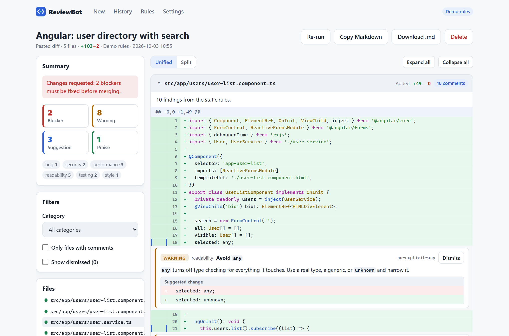
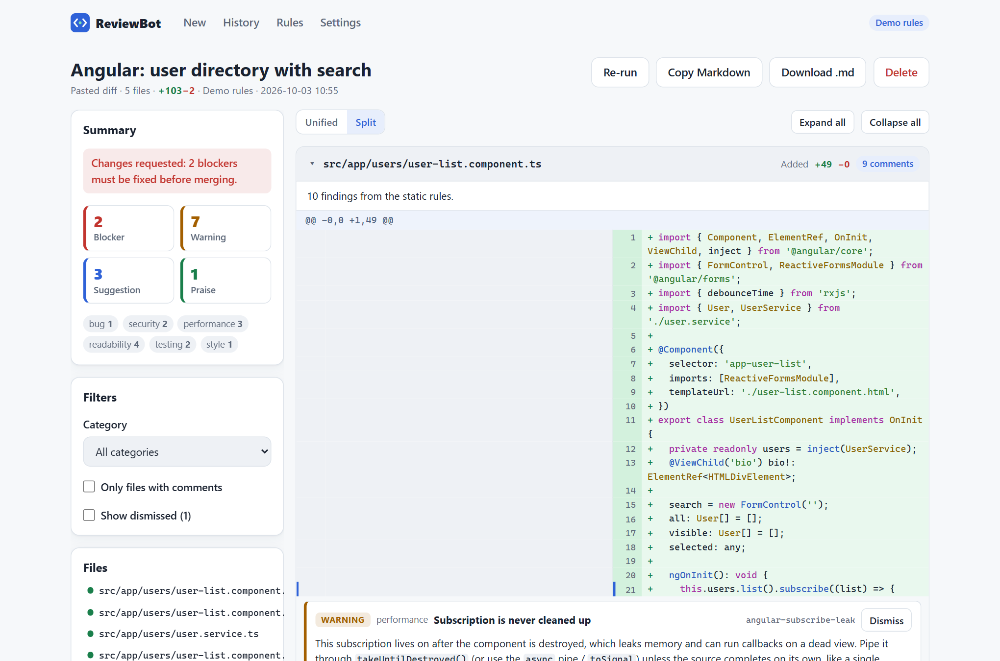
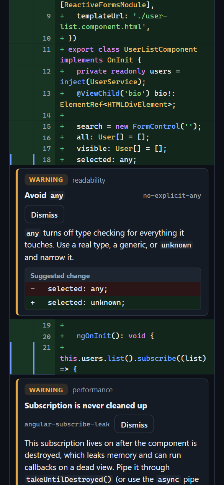
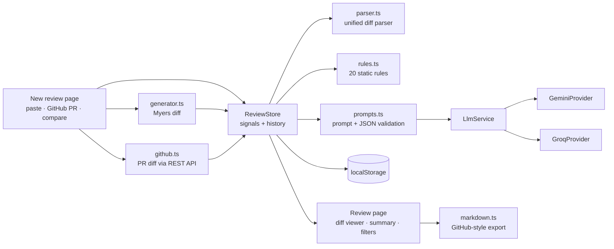

# ReviewBot


Line-by-line code review in the browser. Paste a unified diff, point at a public GitHub pull request, or compare two snippets, and ReviewBot renders the diff with syntax highlighting and leaves inline comments graded **blocker, warning, suggestion or praise**. Reviews come from a built-in static rule engine (20 checks, works offline) or from Gemini / Groq with your own key, and export as a GitHub-ready Markdown comment.

**[▶ Live demo](https://konicamaheshwarii.github.io/pr-reviewer/)**: works instantly in Demo mode, no key or sign-up needed. Click a sample and press *Review changes*.



## Features

- **Three ways in.** Paste a unified diff (or open a `.diff` / `.patch` file), fetch a public GitHub PR by URL (`owner/repo#123` works too), or compare two snippets: the diff is computed in the browser with the Myers algorithm.
- **A robust diff parser.** Multiple files, hunks with old/new line numbers, renames and copies with similarity, new/deleted files, mode changes, binary files (`Binary files … differ` and `GIT binary patch`), quoted paths with octal escapes, CRLF input, `diff -u` timestamps and `\ No newline at end of file`. Hunk bodies are read by their line counts, so a removed `-- comment` line is never mistaken for a file header.
- **Diff viewer.** Collapsible files, unified and split (side-by-side) views, line numbers on both sides, syntax highlighting for TypeScript/JavaScript, HTML, CSS/SCSS, JSON and Python from a small built-in tokenizer (no highlighting library).
- **Inline review comments** under the exact line, with severity, category (bug, security, performance, readability, testing, style), explanation and a *suggested change* block. Dismiss or restore any comment.
- **Summary panel** with a merge verdict, counts by severity (click to filter) and category, plus filters for category, source (AI or rules) and files with comments.
- **Static rule engine (Demo mode).** 20 rules, including `console.log` / `print` left in, `debugger` and `breakpoint()`, `any` types, TODO/FIXME, empty `catch` / `except: pass`, `==` vs `===`, hard-coded secrets and keys, Angular `subscribe()` without `takeUntilDestroyed`, `innerHTML` and `bypassSecurityTrust*`, `` without `alt`, very long lines and functions, magic numbers, `async` without `await`, `eval`, focused and skipped tests. See them all on the in-app *Rules* page.
- **AI review (bring your own key).** Each file's hunks are sent to Gemini or Groq with explicit line labels; the JSON reply is validated before anything is shown. Optionally runs the static rules alongside.
- **Markdown export** in GitHub comment style (summary table, per-file sections, `diff` snippets and `suggestion` blocks) via copy or download.
- **History** of the last 25 reviews in localStorage, with re-run and *retry failed files*.
- **Three bundled sample PRs** (Angular, Node.js, Python), light/dark themes and a layout that works down to 390 px.

| Split view | Mobile, dark |
|---|---|
|  |  |

## Architecture



Key design decisions:

- **Line numbers are the contract.** The prompt labels every line as `R12` (new file) or `L12` (old file). Model replies are parsed defensively (code fences, prose and `<think>` tags stripped), severities and categories are mapped onto the known sets, duplicates removed, and any comment pointing at a line that is not in the diff is discarded and counted, so a hallucinated line number never renders.
- **Rules look at code, not text.** The same tokenizer that colours the diff masks strings and comments before rules match, so `"a == b"` inside a string is not flagged, while the TODO rule reads only comments. Rules only comment on added lines; block rules (long function, `async` without `await`) only fire when the whole body is visible in the diff.
- **One pipeline for both reviewers.** Rule comments and AI comments share one model (`ReviewComment`) and one viewer. The `DemoProvider` answers review requests with rule-engine output in the model's JSON shape, and a test runs that output through the AI validator to prove every rule line number is valid.
- **Signals and zoneless.** `ReviewStore` and `SettingsStore` hold state in signals; the review page re-parses the diff only when the diff text changes, not on every comment update. Components are standalone and `OnPush`, routes are lazy-loaded, initial transfer is about 68 kB.
- **Bounded work.** Files are reviewed two at a time, large files are split into batches of whole hunks, lock/generated/binary/deleted files are skipped, requests are cancellable, and history trims itself when localStorage is full.
- **Prompt-injection hygiene.** Diff content is fenced in `<diff>` tags and the system prompt says it is untrusted data.

```
src/app
├── core
│   ├── diff/          models, unified diff parser, Myers generator, tokenizer
│   ├── review/        rules, prompts + validation, markdown export, ReviewStore
│   ├── llm/           provider interface, Gemini, Groq, Demo
│   ├── github.ts      PR URL parsing and diff fetch
│   ├── samples.ts     bundled sample pull requests
│   └── settings.store.ts
├── features/          new review · review · history · rules · settings
└── shared/            diff file viewer, comment thread, inline-code pipe
```

## Getting started

```bash
npm install
npm start          # http://localhost:4200
npm run test:ci    # unit tests in headless Chrome
npm run build
```

Open **Settings** to switch from Demo to Gemini or Groq and paste a free key:
[Gemini](https://aistudio.google.com/apikey) · [Groq](https://console.groq.com/keys).
Keys stay in your browser and go straight to the provider; there is no backend. An optional GitHub token raises the API limit from 60 to 5,000 requests an hour.

## Testing

67 unit tests cover the logic most likely to break:

- **Diff parser:** line numbering, multiple hunks, new/deleted/renamed/mode-only files, both binary formats, `\ No newline`, removed lines that look like headers, CRLF and `diff -u` input, quoted and spaced paths, truncated hunks, and all three samples.
- **Diff generator:** Myers shortest edit script, hunk grouping, and round trips (generate, parse, re-apply) for inserts, deletes, new and deleted files and missing final newlines.
- **Every rule**, with positive and negative cases, plus a check that the samples trigger all 20.
- **AI comment validation:** JSON extraction, dropping lines outside the diff, side inference, severity/category mapping, duplicates.
- **Markdown export**, the GitHub client (URL parsing, headers, rate-limit and 404 errors), the review store (file-by-file review, partial failure and retry, Demo mode, persistence) and the split-view pairing.

CI (GitHub Actions) runs the tests and the production build on every push, then deploys `main` to GitHub Pages.

## License

[MIT](LICENSE)
